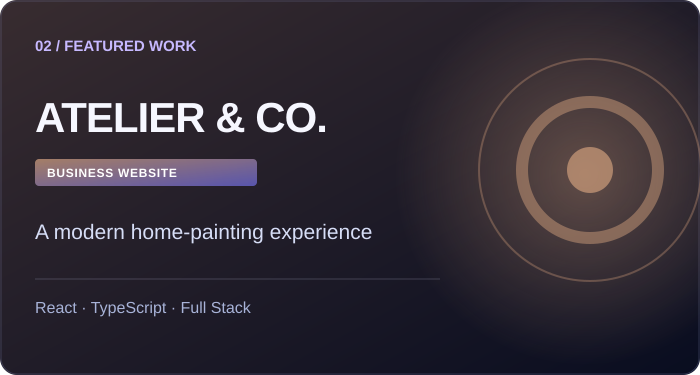

<div align="center">

[](https://github.com/abir230161)

### Developer · CSE Student · Curious Builder

Building modern digital products with a focus on **web development, AI & cybersecurity**.

[](https://github.com/abir230161)
[](https://abir230161.github.io/Abir-Portfolio/)

</div>

---

### ✦ About me

I'm **Abir Ahmed**, a Computer Science & Engineering student interested in turning ideas into polished, useful digital experiences. My work includes responsive web applications, e-commerce interfaces, client websites and AI-driven business tools. I'm also learning Linux, networking and cybersecurity.

```typescript
const abir = {
  building: ["Modern Websites", "AI-Powered Products"],
  exploring: ["Cybersecurity", "Linux", "Networking"],
  principle: "Keep learning. Keep building.",
};
```

### ⚡ Technologies I work with

<div align="center">


</div>

### ◈ Featured projects

<table>
<tr>
<td width="33%" valign="top">


**NORAT SPARK**  
Responsive e-commerce platform and animated storefront.  
`Next.js` `TypeScript` `E-Commerce`

</td>
<td width="33%" valign="top">



**ATELIER & CO.**  
Home-painting business website and customer experience.  
`React` `TypeScript` `Full Stack`

</td>
<td width="33%" valign="top">


**ZELQOVIRA**  
AI-powered business intelligence and operations SaaS in development.  
`Next.js` `AI` `Analytics`

</td>
</tr>
</table>

> Some featured projects are private or still in development. The artwork above is illustrative, not screenshots of deployed applications.

### ◉ What I'm exploring

- **Frontend engineering:** clean interfaces, responsive design, interaction details
- **Full-stack products:** databases, APIs, authentication, product workflows
- **AI products:** practical automation and analytics experiences
- **Security foundations:** Linux, networking and secure development

### ☎ Connect

Open to collaborating on thoughtful projects and exchanging ideas. Explore my [portfolio website](https://abir230161.github.io/Abir-Portfolio/) or visit my [GitHub profile](https://github.com/abir230161) to connect.

<div align="center">

---

*Crafted with curiosity, by Abir Ahmed.*

</div>
