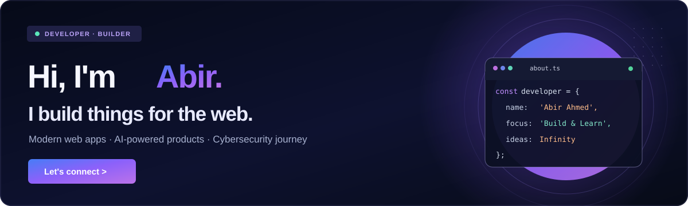
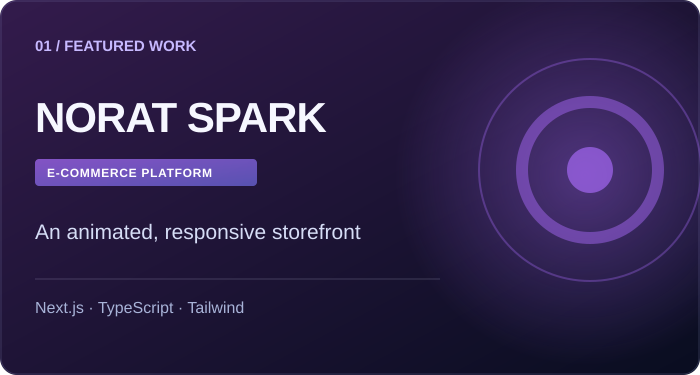
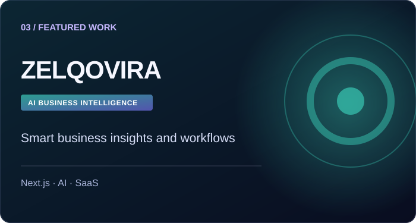
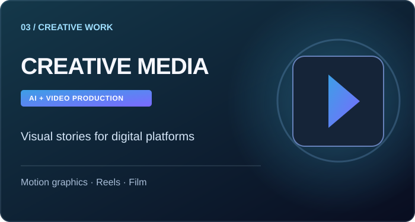

 

### Web Developer &nbsp;·&nbsp; Creative Media &nbsp;·&nbsp; CSE Undergraduate

*Building responsive web experiences and telling stories through digital visuals.*

---

### ✦ About Me

Hi, I'm **Abir Ahammed**, a **Computer Science & Engineering undergraduate** working at the intersection of **web development and creative media**.

I create responsive web products, explore AI-assisted motion graphics, produce short-form videos and approach visual storytelling through cinematography. I enjoy combining technical problem-solving with thoughtful design and engaging digital experiences.

### 💼 Professional Experience

**Amader Shomoy.com — News & Digital Content** &nbsp; `Current`

- Working with a news platform on digital content and news-oriented storytelling.
- Refining headlines and shaping content for digital audiences.

### 🚀 Selected Projects

<table>
<tr>
<td width="50%" valign="top">

<h3>NORAT SPARK</h3>

<b>E-Commerce Website</b>

A responsive online storefront featuring product discovery, media-rich sections and shopping interactions.

<code>Next.js</code> <code>TypeScript</code> <code>Responsive UI</code>

</td>
<td width="50%" valign="top">

<h3>ZELQOVIRA</h3>

<b>AI-Oriented SaaS Website</b>

A modern product interface with responsive layouts and dashboard-style experiences.

<code>Next.js</code> <code>AI</code> <code>Dashboard UI</code>

</td>
</tr>
</table>

Project images are illustrative, not screenshots. NORAT SPARK's website URL is listed as its GitHub repository homepage; current live availability has not been independently confirmed. No direct ZELQOVIRA demo link has been verified.

### 🎬 Creative Media Experience

<table>
<tr>
<td width="40%" valign="top"></td>
<td valign="top">
<b>AI Motion Graphics & Video Creation</b> 
AI-assisted visual production and motion-graphics projects.  
<b>Facebook Reels & Short-Form Content</b> 
Social-first videos focused on cuts, pacing, engaging visuals and storytelling.  
<b>Cinematography</b> 
Camera composition, shot planning, cinematic video capture and visual storytelling.
</td>
</tr>
</table>

### ⚡ Skills & Technologies

**Web Development**

**Creative & Content Tools**

**What I Build:** Responsive UIs · Web Applications · Digital Product Interfaces

**Creative Skills:** AI Motion Graphics · AI Video Workflows · Video Editing · Reels · Cinematography

**Other Tools:** Canva · Microsoft Word · Microsoft Excel

### 📊 GitHub Activity

<table>
<tr>
<td width="50%" align="center" valign="top">

</td>
<td width="50%" align="center" valign="top">

</td>
</tr>
</table>

These are external live cards. Private project activity may be absent, and external image services can temporarily fail.

<b>See extended contribution activity</b>

 

### 🐍 Contribution Snake

Generated automatically by <code>.github/workflows/snake.yml</code>.

### 🎓 Education

**B.Sc. in Computer Science & Engineering** — Undergraduate studies ongoing

Earlier education & languages

- **HSC (Science)** — Civil Aviation School & College, Dhaka Board, 2022
- **SSC (Science)** — Uttarda High School, Cumilla Board, 2020
- **Languages:** Bangla (Native) · English (Working proficiency)

### 🤝 Strengths

Teamwork · Fast learning · Attention to detail · Creative thinking · Communication · Adaptability

---

### 📫 Let's Connect

Interested in web development, creative media or a new collaboration? Feel free to reach out.

- **Portfolio:** [abirahammed.pythonanywhere.com/](https://abirahammed.pythonanywhere.com/)
- **Email:** [abirrohitahmed@gmail.com](mailto:abirrohitahmed@gmail.com)
- **GitHub:** [@abir230161](https://github.com/abir230161)

---

Web development × Creative media — keep learning, keep creating.

